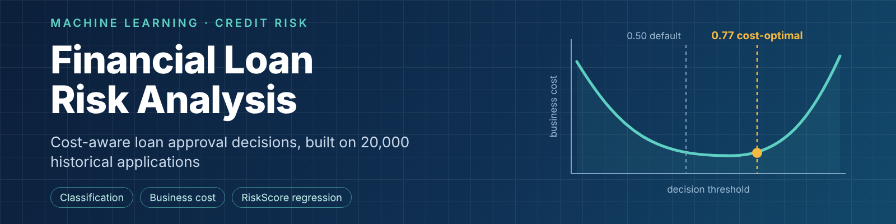

   [View the notebook](https://nbviewer.org/github/zainabraho288-code/financial_loan_risk/blob/main/financial_loan_risk.ipynb)

# Financial Loan Risk Analysis

Machine learning to support loan approval decisions for FinTech Innovations, using 20,000 historical loan applications.

## Overview

Loan applications are currently reviewed manually, which can be slow and inconsistent. This project builds two models:

1. **Classification (main):** predicts whether an application was approved (`LoanApproved`).
2. **Regression (secondary):** predicts the existing `RiskScore`, so the score can be produced consistently.

The two errors have very different costs, so models are chosen by **business cost**, not accuracy:

| Error | Meaning | Estimated cost |
|---|---|---|
| False negative | Creditworthy applicant denied | $8,000 |
| False positive | Applicant who defaults is approved | $50,000 |

A false approval costs about 6.25 times more than a false denial.

## Repository contents

| File | Description |
|---|---|
| `financial_loan_risk.ipynb` | Full analysis: business understanding, EDA, cleaning, modelling, evaluation |
| `financial_loan_data.csv` | Raw dataset (20,000 rows, 35 columns) |
| `README.md` | This file |

## Data

- **Target:** `LoanApproved` (1 = approved, 0 = denied). Class split is 23.9% approved and 76.1% denied.
- **Secondary target:** `RiskScore`. It is **excluded from the classification features** because it is strongly related to the approval decision (correlation about -0.77).

### Data cleaning

| Issue | Treatment | Reason |
|---|---|---|
| `AnnualIncome` stored as text (e.g. `$39,948.00`) | Removed `$` and commas, converted to a number | Models need numeric input |
| `BankruptcyHistory` stored as Yes/No | Encoded as 0/1 | Models need numeric input |
| `EducationLevel` missing (4.5%) | Kept as an "Unknown" category | Avoids assuming missing values match the majority group |
| `MaritalStatus` missing (6.65%) | Kept as an "Unknown" category | Same as above |
| `SavingsAccountBalance` missing (2.9%) | Filled with 0 and added a missing-value indicator | A blank may mean no savings account (an assumption); the indicator lets the model learn whether missingness matters |
| Duplicates | None found | |

All imputation and encoding is done inside the model pipeline, so it is fitted on training data only. This avoids data leakage.

## Method

- **Split:** 80/20 stratified train/test (16,000 / 4,000), with the test set untouched until final evaluation.
- **Models compared (5-fold CV):** Logistic Regression, Decision Tree, Random Forest, HistGradientBoosting, K-Nearest Neighbours, Gaussian Naive Bayes.
- **Tuning:** `RandomizedSearchCV` on Random Forest, HistGradientBoosting and Logistic Regression, scored on business cost.
- **Threshold:** the decision threshold was chosen from out-of-fold training predictions to minimise business cost.
- **Interpretability:** tree importance, permutation importance and Logistic Regression coefficients.
- **Fairness check:** predicted and actual approval rates compared across employment, education, marital and home-ownership groups.

## Results

### Classification (4,000 held-out applications)

| Policy | Business cost |
|---|---|
| Approve everyone | $152,200,000 |
| Credit-score-median rule | $75,146,000 |
| Deny everyone | $7,648,000 |
| Logistic Regression (0.50 threshold) | $6,274,000 |
| HistGradientBoosting (0.50 threshold) | $3,744,000 |
| **HistGradientBoosting (0.77 threshold)** | **$2,514,000** |

- **Selected model:** HistGradientBoosting, test ROC-AUC 0.993.
- **Cost-optimal threshold:** 0.77 instead of 0.50, because false approvals are so expensive.
- **Trade-off:** at 0.77, approved-class precision is 0.99 but recall falls to 0.73 (0.90 at the 0.50 threshold). The model approves fewer applicants, so some creditworthy people are denied.
- **Interpretable benchmark:** tuned Logistic Regression reached a test ROC-AUC of 0.995, so a simpler model separates the classes well too, but it has a higher business cost.
- **Most influential features:** income, debt-to-income measures, credit score, payment history, previous defaults and bankruptcy history.

### Regression (`RiskScore`)

Random Forest Regressor: test MAE 1.70, RMSE 2.72, R² 0.881.

## Limitations

- `LoanApproved` is the **historical decision**, not a repayment outcome. The model learns to reproduce past approvals and will repeat any bias in them.
- The $8,000 and $50,000 costs are estimates from the problem brief, and the threshold depends on them.
- The "Unknown" education level is ranked lowest in the ordinal encoding, which is a modelling choice.
- Treating a missing savings balance as 0 is an assumption.
- Segment checks are a starting point, not a full fairness audit, and should be repeated after deployment as the applicant population changes.
- The model should support loan officers, not replace their final decision.

## How to run

1. Install the requirements: `pip install pandas numpy matplotlib seaborn scipy scikit-learn jupyter`
2. Put `financial_loan_data.csv` in the same folder as the notebook, and make sure the notebook's `pd.read_csv(...)` line points to it.
3. Open `financial_loan_risk.ipynb` and run all cells.
